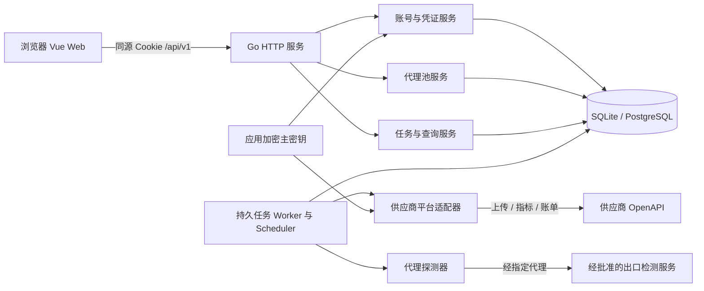
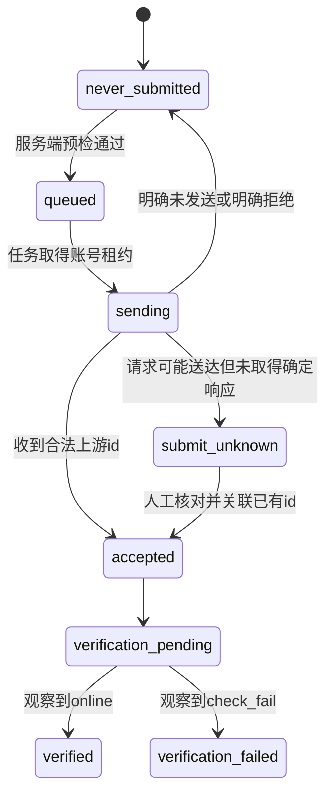

# CC Max 上号器：总体与后端方案

> 设计稿 v1.0，2026-11-04。当前仓库已有原型代码；本文件仍是目标架构与边界，尚未实现的部分以项目根目录 README 的实现状态为准。平台事实见 [平台对接说明](platform-contract.md)。

## 1. 目标、范围与成功标准

### 1.1 产品目标

为持有 Claude Code Max 账号的操作者提供统一 Web 后台：页面填写账号或导入凭证、固定绑定代理、校验和上传平台、追踪账号状态、查看逐账号 Token 和金额消耗。

首批重点为 Max 5x / Max 20x，数据结构兼容平台列出的 Pro 套餐，但是否开放由管理员配置的授权套餐控制。

### 1.2 系统负责什么

- 本地账号库存、资料、套餐日期、标签、凭证版本和上传记录。
- 本地代理池的管理、质量检测、账号绑定及故障预警。
- 平台 OpenAPI 连接、上传队列、验证结果追踪和历史用量同步。
- 管理员登录、秘密加密、操作审计、备份与恢复。
- 凭证填写和导入；后续通过可替换适配器接入经确认的授权、刷新流程。

不包含模型推理接口、模型路由、对外售卖 API Key、自动注册账号、购买订阅、支付或自动处理验证码。

### 1.3 首版验收目标

1. 只用 Web 表单即可保存账号草稿，补齐平台要求的凭证并完成预检。
2. JSON 导入与表单填写采用相同的数据模型和服务端校验。
3. 代理可独立管理、测试并绑定账号，绑定在本地和上传快照中可追踪。
4. 上传任务持久化；成功后保存上游 `id`；超时不盲目重发。
5. 可逐账号查看平台状态、请求数、Token、成功率和离线金额，并识别旧数据/未知值。
6. 密码、Token、代理密码不进入普通响应、日志、审计正文或浏览器持久缓存。
7. 未确认的平台能力在界面和 API 上明确关闭，不通过模拟成功来绕过缺口。

## 2. 总体架构



首版单个 Go 进程托管 REST API、构建后的前端静态文件、Scheduler 和 Worker。外部只暴露同源管理入口；不引入微服务。

## 3. 技术路线与理由

| 层 | 建议 | 理由与边界 |
| --- | --- | --- |
| 后端 | Go，`net/http` 标准路由，分层服务 | 项目原始定位为 Go；标准路由满足本地 CRUD 和任务接口，避免为简单需求引入框架 |
| 数据访问 | `database/sql` + 手写参数化查询 + 版本化 SQL migrations | 保持约束、事务和幂等行为可审查；不依赖 ORM 隐式更新秘密字段 |
| 首版数据库 | SQLite，WAL、外键约束、busy timeout | 单机部署简单；需要 SQLite 驱动，实施时评估维护状态并锁版本 |
| 后续数据库 | PostgreSQL | 多实例或持续写入压力出现后迁移；首版不假装两者所有 SQL 可直接共用 |
| 前端 | Vue 3、TypeScript、Vite、Element Plus | 表格、表单、任务详情为主要交互；见前端方案 |
| 前端数据 | TanStack Vue Query；Pinia 仅保留 UI 和会话摘要 | 请求缓存与失效交给查询层，不复制一份可变业务状态 |
| 图表 | ECharts，按需导入 | 账号趋势、日用量与费用对比 |
| 后台任务 | 数据库任务表 + Go Worker | 上传、验证、代理检测和数据同步都需要重启恢复，首版不需要 Redis |
| 金额 | 后端整数分，JSON 十进制字符串 | 避免浮点运算和 JavaScript 整数精度问题 |
| 加密 | AES-256-GCM + 应用层密钥版本 | Go 标准库实现；每条秘密随机 nonce，密文绑定资源身份 |
| 本地登录 | 服务端 Session、HttpOnly Cookie、CSRF 令牌 | 不把长期访问令牌放入 localStorage |

本文是技术选型方案，不执行依赖安装。实施阶段选择仍受维护的 Go/Node 稳定版本，核对 SQLite 驱动、密码哈希与前端依赖的官方文档，并提交锁文件。

## 4. 部署与目录

### 4.1 拟定目录

```text
cc-manager/
  cmd/cc-manager/main.go
  internal/
    app/                 # 依赖装配、启动与关闭
    config/              # 配置解析；不返回秘密原值
    httpapi/             # handler、认证/CSRF、错误映射
    domain/              # 账号、凭证、代理、平台、任务、用量类型
    service/             # 跨仓储业务事务与状态推进
    repository/          # 参数化 SQL；sqlite / postgres 实现
    validation/          # 草稿、预检、平台约束、JSON 合并
    provider/supplier/   # Claude 上传、metrics、bill 适配器
    provider/claudeauth/ # 后续授权能力接口，默认未配置
    proxy/               # URL、HTTP CONNECT、SOCKS 探测
    jobs/                # 队列、租约、调度、退避、恢复
    crypto/              # SecretBox、密钥轮换、解密上下文
    audit/               # 审计事件与白名单脱敏
    observability/       # 结构化日志、内部指标
  migrations/sqlite/
  migrations/postgres/   # P1 有迁移需求后再实现
  web/                  # Vue 应用
  deploy/               # 配置模板、容器与备份说明
  docs/
```

> **实际实现（2026-11-08）与上图不同**：当前代码只有 `internal/app`（路由 `router.go`、配置 `config.go`、HTTP 帮助 `httpx.go`、安全 `security.go`、迁移 `migrations.go`、worker/janitor、各域 handler）、`internal/supplier`、`internal/crypto` 三个包；`config/httpapi/domain/service/repository/...` 的拆分尚未进行。前端为 `web/src/{views,layouts,components,composables,model,types,utils}`。

### 4.2 运行方式

- 本机试用：默认监听 `127.0.0.1`，由同一服务返回前端和 API。
- 服务器：管理入口使用 HTTPS，可由反向代理终止 TLS；Go 仅监听受控内网地址。
- 只支持同源前端；首版不开放宽泛 CORS。
- 只有一个 Scheduler/Worker 进程实例；启动锁阻止误启动第二个 SQLite 写入实例。
- 平滑退出时停止接收任务，完成短事务并释放租约；不在退出中重发结果不明的上传。
- 数据目录存数据库、加密秘密、受限日志；主密钥通过独立配置注入，不能和数据库默认放在同一备份中。

### 4.3 关键配置

| 配置 | 目的 | 初始建议 |
| --- | --- | --- |
| `server.listen` | 管理接口地址 | `127.0.0.1:8080` |
| `storage.driver` / `storage.dsn` | 数据库 | SQLite 本地文件 |
| `security.active_key_id` | 当前加密密钥版本 | 管理员初始化 |
| `security.keyring_file` | 密钥来源 | 独立受限路径或挂载 secret |
| `scheduler.enabled` | 同步调度开关 | 开启；无已交付账号时空转 |
| `worker.max_concurrency` | 后台总并发 | 4，可配置 |
| `worker.platform_concurrency` | 单平台请求并发 | 2，联调后调整 |
| `sync.metrics_interval` | 指标刷新周期 | 2 分钟 |
| `sync.billing_interval` | 当日账单刷新 | 2 小时 |
| `retention.import_preview_ttl` | 导入草稿寿命 | 15 分钟 |
| `features.claude_oauth` | 自动授权入口（历史配置设计） | 2026-11-09 已实现浏览器授权回填；无此配置开关，按 `accounts.onboard` 权限开放 |
| `features.claude_refresh` | 自动刷新流程 | 默认关闭 |

上述数值是本地初始策略，不是已确认的平台限流或容量承诺。

> **实际实现**：配置全部来自 `CC_MANAGER_*` 环境变量（见根 README「配置项」），没有配置文件、`keyring_file` 或并发度参数；worker 为固定的 4 个单协程循环（任务、指标、账单、调度）加 1 个清理循环。

## 5. 后端模块

### 5.1 AccountService

- 草稿新增、分页查询、局部更新、归档和恢复。
- 拆分基本资料、敏感密码、凭证元信息，列表查询不解密秘密。
- 保持本地账号 ID 稳定，远端 `id` 和 `aid` 单独保存。
- 每次影响交付的修改增加 `version`；已上传账号同时增加 `delivery_config_version` 并标记 `out_of_sync`。
- 套餐、标签、凭证与代理改变不会自动调用不存在的上游更新接口。
- 本地归档仅隐藏和停止常规周期同步，不代表远端下号；仍有未结束上传任务时禁止归档。

### 5.2 CredentialService

- 支持完整 JSON 导入、逐字段填写、局部合并和完整替换。
- 以原始 JSON 对象为基础保留额外字段；禁止固定结构序列化导致字段丢失。
- 额外字段仍受 JSON 深度、体积、键名重复等通用输入限制。
- GET 只返回字段是否存在、缺项、过期时间、格式错误和版本等元信息。
- `PATCH` 未出现的字段保持原值；显式 `null` 删除该键，使账号回到待补全状态；`id_token:""` 合法。
- 前端传回掩码占位符不视为真实 Token，返回字段错误。
- 密码替换单独作为写入字段；没有提交 `password` 就保持原密码，禁止把空字符串误作“未修改”。
- 后续自动刷新要有按账号互斥锁和一次性 refresh-token 轮换保存机制；平台刷新责任未知时不开启。

### 5.3 ProxyService

- 管理本地代理资源、健康快照、检测历史及固定账号绑定。
- 代理密码分开加密，列表只返回无密码的脱敏 URL。
- 导入凭证中的 `proxy_url` 先解析为候选代理，用户确认创建或复用；不能静默向该地址发起连接。
- 固定绑定是本地交付配置；代理池测活失败只发预警，不对已交付账号自动轮换出口。
- 探测分为 TCP/握手、经代理 HTTPS 请求、出口 IP 识别；不同阶段有独立错误原因。
- 出口检测只访问管理员配置的无账号敏感数据的探测服务，不调用模型接口消耗账号额度。
- 不将 Claude Token、平台 Token 或账号邮箱传给公共代理检测服务。
- 对 `socks5h` 保留远端 DNS 语义；IPv6 地址使用方括号；用户名/密码使用标准 URL 编码。
- 支持代理私网部署，但必须由管理员加入允许目标范围；默认阻止回环、链路本地、云元数据及管理面地址。
- 校验 DNS 解析后的 IP，连接时固定已校验地址，限制重定向和重解析，防止 SSRF/DNS rebinding。

### 5.4 SupplierAdapter

定义三个首版能力：`SubmitClaudeAccount`、`QueryMetrics`、`QueryBills`。另外提供不发送网络请求的配置校验。

平台连接测试使用已关联账号的只读指标查询；没有账号 ID 时显示“连接资料已校验，尚未验证远端鉴权”，不假定有健康检查或 Token introspection 接口。

适配器统一处理：

- 管理员配置的固定 origin 和文档中已确认的路径。
- TLS 验证、超时、响应体限制、错误脱敏、JSON 类型与字段容错。
- 上游 ID 作为整数精确解析，本地 API 将其表示为字符串，避免 JS 误差。
- 401/403 识别为平台连接/权限异常，不自动判定 Claude 账号被封。
- 读类 POST 的重试与创建类 POST 的不确定结果分开处理。
- 未知平台状态作为原始字符串保留，业务层映射为 unknown，不使整个批次失败。

TLS 证书错误应提示管理员配置受信 CA/证书或修复服务证书；不以关闭校验作为默认接入方案。

### 5.5 UsageService

- 分开存储窗口指标快照和逐日离线账单。
- 每个结果记录 `window_start/end`、平台时区、`fetched_at`、来源、缺失字段和同步错误。
- 查询窗口内累计指标采用 upsert/版本覆盖，绝不将每次轮询累计值重复相加。
- 日账单以账号 + 平台 + 日期唯一，重复同步覆盖当前版本并记录修订，不累加。
- Token 和请求计数使用 int64，API 用十进制字符串；缺数据仍为 null。
- 金额使用整数分；只写离线账单，不写实时 metrics 中被停用的 `cost`。
- 不用本地 API 价格估算替代平台账单，也不把金额展示为供应商净收益。

### 5.6 ImportService

- 明确选择导入格式：单份凭证、账号清单、平台上号对象；不通过不可靠的字段猜测混用。
- 预览阶段解析、校验、查重和列出字段来源，返回脱敏结果，不写正式账号；代理文本导入也复用该预览机制。
- 临时导入会话在后端加密保存，15 分钟过期；前端仅保留 `import_id`。
- 用户选择后逐条提交到本地库存，不自动上传平台。
- 一个批次中允许有效行入库、无效行保留错误；返回每行结果，不把部分成功描述为全部成功。
- 对重复账号提供“跳过/显式更新本地草稿”，已交付账号不通过导入静默覆盖其交付快照。

## 6. 数据模型

### 6.1 通用约定

- 本地业务主键为 UUID 字符串。上游 `id`、`aid` 采用独立精确整数列。
- 除业务日期外，时间以 UTC 保存并使用 RFC3339 输出；业务日期使用 `YYYY-MM-DD`。
- 本地 `version` 为递增整数，更新必须带 `expected_version`，冲突返回 409。
- 关联用户、任务、账号和秘密采用外键，不使用日志文本作为关联依据。
- 所有可变业务记录有 `created_at`、`updated_at`；账号归档使用 `archived_at`。

### 6.2 核心表

| 表 | 关键字段 | 约束与用途 |
| --- | --- | --- |
| `users` | id, username, password_hash, role, disabled_at | username 唯一；首版只有管理员，可预留 operator/viewer |
| `sessions` | id_hash, user_id, expires_at, last_seen_at, csrf_hash | 服务端可撤销会话，不存明文 session token |
| `accounts` | id, account, identity_key, plan, register_location, register_time, plan_start_time, plan_end_time, proxy_id, password_secret_id, metadata_json, version, delivery_config_version, archived_at | identity_key数据库唯一（含归档记录）；归档后重用应恢复原账号，不能新建绕过唯一约束 |
| `account_credentials` | account_id, secret_id, credential_version, schema_version, present_fields_json, missing_fields_json, validation_state, last_refresh, expired, content_hmac, proxy_source_state, proxy_resolution_json | 每账号当前版本唯一；代理来源决议绑定账号/凭证/代理版本；历史秘密按保留策略有限保存 |
| `proxies` | id, name, scheme, host, port, username_secret_id, password_secret_id, enabled, version, allowed_network_profile, source | 代理地址和认证规范化后做 HMAC 去重；禁止明文认证 URL 列 |
| `proxy_checks` | id, proxy_id, proxy_version, probe_generation, state, exit_ip, latency_ms, stage, error_code, checked_at | 结果绑定检测快照版本；旧版本迟到结果仅入历史，不更新当前健康 |
| `platform_connections` | id, name, base_url, token_secret_id, timezone, allowed_plans_json, enabled, version | origin/timezone在有平台关联、交付尝试或采集数据任一项后不可变；Token只写，可受控轮换 |
| `platform_links` | id, account_id, platform_connection_id, upstream_id, upstream_aid, alias, ingestion_state, runtime_status, runtime_status_raw, submitted_config_version, out_of_sync, last_observed_at | 唯一(account_id, connection_id)；唯一(connection_id, upstream_id)；ID 未确认时允许 null |
| `submission_attempts` | id, link_id, job_id, snapshot_secret_id, config_version, credential_version, proxy_version, request_hmac, transport_phase, outcome, upstream_id, sent_at, completed_at | 不可变交付快照；保留原请求的加密快照以排查不确定结果 |
| `jobs` | id, kind, account_id, connection_id, state, priority, attempts, max_attempts, run_after, lease_owner, lease_expires_at, idempotency_record_id, progress_json, attention_reason, last_error_code | worker 持久队列；租约过期不是上传可重发的证据 |
| `job_events` | id, job_id, level, code, safe_message, occurred_at | 仅脱敏事件；按 job_id + occurred_at 索引 |
| `idempotency_records` | actor_id, operation, key, payload_hmac, job_id, expires_at | 唯一(actor,operation,key)，同键异参返回409 |
| `metric_snapshots` | account_id, connection_id, bucket_kind, bucket_key, window_start, observed_window_end, requests, prompt_tokens, completion_tokens, success_rate, status_raw, fetched_at, source_timezone, sync_generation | 唯一(account,connection,bucket_kind,bucket_key)；业务日桶键稳定，不能用不断变化的end作为当日唯一键；无金额字段 |
| `bill_daily` | account_id, connection_id, bill_date, request_count, prompt_tokens, completion_tokens, cache_read_input_tokens, cache_write_input_tokens, cost_fen, source_range_json, fetched_at, revision, sync_generation | 唯一(account,connection,bill_date)；可修订；条件写入最新同步代次 |
| `sync_cursors` | connection_id, kind, partition_key, issued_generation, applied_generation, covered_through, last_success_at, last_error_at | 按分区租约串行并单调发放代次；旧响应不覆盖新数据，持久化后才推进，失败分片独立恢复 |
| `import_sessions` | id, owner_id, encrypted_payload_secret_id, format, summary_json, expires_at, committed_at | 预览内容短期保存；commit 结果可恢复查询 |
| `secret_records` | id, key_id, nonce, ciphertext, resource_type, resource_id, created_at | 密文认证上下文绑定资源类型和ID，密钥不在表内 |
| `audit_events` | id, actor_id, action, resource_type, resource_id, request_id, safe_diff_json, occurred_at | 只记字段名、版本和结果，不存原始秘密值 |

### 6.3 身份、绑定和删除规则

- `account` 不允许空白字符；保存输入原貌，另建匹配键。邮箱域名可规范化；本地邮箱匹配按明确产品规则忽略大小写，非邮箱登录 ID 不擅自小写。
- `accounts.identity_key`在数据库中唯一；同一账号归档后恢复原记录，不生成另一UUID绕过去重。同一平台连接的同一本地账号只能有一份交付关系；换套餐不绕过平台“同一账号不可重复”的约束。
- 代理与账号为多对一；界面可显示一代理绑定多少账号。不强制一代理一个账号，但可配置容量告警。
- 正在使用的代理只能停用/标记待处理，不能物理删除；用户先重新绑定草稿账号，再归档代理。
- 已交付账号变更代理只能改变本地目标配置并产生 `out_of_sync`；旧交付快照持续可追踪。
- 账号首版只提供本地归档，禁止级联删除历史账单、任务和平台关联。
- 所有对已交付账号敏感配置的变更需提示其远端尚未生效，不后台自动补一次创建请求。
- 平台连接存在平台关联（包括人工关联的历史ID）、交付尝试（包括结果未知）或采集记录中的任一项后，origin和timezone不可修改。换平台/时区必须新建连接，历史ID与业务日数据仍属于旧连接，不能将旧ID自动带到新origin。

## 7. 状态模型

不要用一个 `status` 同时表达本地资料、授权、上传和远端运行状态。

| 维度 | 值 | 判断依据 |
| --- | --- | --- |
| 本地记录 | draft / active / archived | 用户保存、资料补全与归档 |
| 凭证 | missing / incomplete / valid_format / expired / invalid_format / unknown | 只代表本地结构和已知有效期；`valid_format` 不表示上游验证成功 |
| 本地就绪 | incomplete / blocked / ready | 预检汇总，不作为远端在线依据 |
| 交付 | never_submitted / queued / sending / submit_unknown / accepted / verification_pending / verified / verification_failed | 上传结果和后续平台观察 |
| 运行 | unknown 或平台原始状态 | 最新成功同步，保留观测时间 |
| 配置同步 | in_sync / out_of_sync / unknown | 当前配置版本与已交付快照版本 |
| 数据新鲜度 | fresh / stale / never_synced / sync_error | 各数据源单独计算 |

`store` 等不明业务状态保留原值；不擅自等同于“验证通过”。首次观察到 `online` 可标记曾验证在线，后续变成 banned/offline 只更新运行维度，不删除历史验收记录。

### 7.1 上传状态推进



验证超过约 5 分钟不立即判失败。10 分钟仍不明时显示 `verification_overdue` 提醒（附加注意标记），继续低频查询；这个提醒不替代交付状态。

### 7.2 任务状态

`queued → running → waiting_external → succeeded / failed / outcome_unknown`；未开始任务允许 `cancelled`。

- 上传被接受后等待平台结果时不占 Worker 执行槽，保存下一次检查时间。
- 结果未知的上传进入 `outcome_unknown`，普通“重试”接口不可重新创建账号。
- 已接受上传不可通过取消本地任务撤回平台交付；只能停止后续本地跟踪并保留记录。
- 同账号的上传与凭证更新使用互斥/版本控制；代理检测、只读同步可以并行。

## 8. 关键业务流程

### 8.1 表单与导入共用链路

1. 保存基础资料和密码（允许草稿）。
2. 选择/新增代理，记录代理版本。
3. 导入或逐字段填写凭证，存为新的凭证版本；导入与表单都调用同一服务。
4. 服务端预检：必填、日期、身份、凭证格式/有效期、代理、连接与套餐授权配置、本地重复交付。
5. 展示阻断项和警告；允许保存但阻止错误状态提交。
6. 提交时重新预检并锁定账号版本，生成加密交付快照和持久上传任务。
7. 上传成功保存原始平台 `id`、别名、版本引用，开始验证跟踪。

表单前端校验只用于即时反馈；后端始终重新校验。预检结果具有账号、凭证、代理、平台配置版本，任一变化后旧结果失效。

### 8.2 本地校验策略

| 校验 | 保存草稿 | 提交平台 |
| --- | --- | --- |
| 缺密码/套餐/日期/凭证 | 返回缺项并允许保存 | 阻断 |
| 明显非法日期、非数字百分比 | 字段有值时返回格式错误 | 阻断 |
| `plan_start_time > plan_end_time` | 显示字段错误，不保存非法组合 | 阻断 |
| 已过期凭证/套餐 | 可保存并标记过期 | 阻断 |
| 代理最近失败或已停用 | 可保存 | 阻断 |
| 代理从未检测或检测过旧 | 可保存 | 要求新检测；默认新鲜度10分钟，可配置 |
| 最近代理检测属于旧配置版本 | 可保存 | 阻断；新端点/认证必须用当前版本重新检测 |
| `auth_json.proxy_url` 与绑定代理不同 | 保存原始输入并要求明确选择覆盖来源 | 未解决冲突则阻断 |
| 注册时间晚于套餐开始等可疑历史关系 | 警告，允许解释 | 非平台明确规则不伪造必填限制 |
| tags互斥 / 数值超范围 | 拒绝非法字段 | 阻断 |
| type等值未知但非空 | 标记“格式通过、语义未核实” | 允许真实凭证样本原值；不能填写本项目生成的占位值 |

代理来源冲突通过版本化决议接口解决：采用当前绑定代理时明确覆盖已知`proxy_url`字段；采用导入代理时先创建/复用该代理资源，再原子更新账号绑定和凭证。决议记录对应版本，不依靠浏览器的临时勾选状态；未知额外凭证字段仍保留。

### 8.3 上传幂等与不确定结果

- 前端每次明确提交动作生成 `Idempotency-Key`，网络重试复用同键。
- 后端在同一事务写入幂等记录、上传意图、队列任务，保证重复点击只生成一个任务。
- 使用 HMAC 记录规范化请求摘要；同键同参返回同一任务，同键异参返回409。
- 远端接口没有文档化幂等支持，因此本地幂等不等于跨系统 exactly-once。
- 在调用前写入 `sending` 和交付尝试；连接前可确定未发送的错误允许重试。
- 请求已可能发送、响应丢失、HTTP 5xx 或进程崩溃后无法证明是否创建时，进入 `submit_unknown`，不自动重试。
- 由用户在平台核对已有记录，再通过受审计的本地关联操作填入 `upstream_id`。
- 没有公开按邮箱查询接口时，不能伪装实现自动查重确认。
- 本地关联的 ID 需要在可查询时核验可访问性；指标返回没有邮箱，不能声称仅凭查询就证明账号身份匹配。界面记录操作者确认。

### 8.4 周期同步与修订

- 平台账号 ID 列表按最多100条分片，后端限制查询窗口不超过7天。
- 默认每2分钟查询当前平台业务日指标；当天窗口从平台本地日零点到当前时间。稳定存储键使用`bucket_kind=business_day`和平台`bucket_key=YYYY-MM-DD`，实际结束时间存为`observed_window_end`。
- 每次覆盖同一个业务日桶，不因当前时间变化而新增可求和的累计行；不将先后两次累计请求相加。自定义固定窗口采用独立bucket_kind及规范化区间键，不与业务日桶混算。
- 日切后在7天允许范围内重查昨日和近2日完整业务日窗口，吸收日终延迟；上游时间范围端点是否包含边界需联调确认，覆盖范围要如实记录，不能假定日末采样已是最终完整值。
- 需要分钟趋势时按明确的小窗口查询；上游“累计窗口”结果不能伪装成瞬时采样速率。
- 实时历史超过7天仅展示本地已保存的可验证窗口；不从上游请求超限范围。
- 日账单逐日查询；正常调度每2小时重查当天与近3天，后续每天分批重查近7天以吸收延迟修订。
- 首次历史补采受90天最早边界约束，分日、分账号批次执行，低优先级且可暂停。
- 同一日金额被修订时替换当前日记录并增加revision，趋势图和汇总从当前日记录重算。
- 部分批次失败不清空成功数据；游标只推进已落库分片，前端展示部分过期。
- 某账号不出现在响应中视为该次无数据，不推断为0、删除或正常。
- 手动和定时同步共享分区锁，分区为`connection + account + source + bucket`。请求前事务分配单调generation，响应仅在代次不旧于已应用结果时写入；租约失效后的迟到响应不能覆盖新值。
- 当前运行状态仅由指定的最新业务日查询链路更新，并遵循状态观测代次；历史补采和自定义旧窗口不覆盖当前运行状态。每个批次保留逐账号分片结果，不以整批成功掩盖单号失败。

## 9. 可靠性、权限与安全

### 9.1 登录与秘密

- 首次本地管理员初始化，不设置公开通用默认密码；密码使用维护中的 Argon2id实现及随机盐。
- Session Cookie HttpOnly；HTTPS环境Secure；SameSite与CSRF校验同时启用。
- 所有变更请求检查CSRF；登录限速并在认证后轮换会话ID。
- 首版单管理员；后续operator可管理账号/任务但不能读取平台Token，viewer只读脱敏数据。
- AES-GCM每次写入使用随机nonce；AAD绑定`resource_type + resource_id + schema_version`，防止密文移用。
- 原始凭证默认不提供下载和回显接口。前端保存后清理敏感表单、query cache和错误对象中的秘密。
- 密钥轮换先验证新旧密钥都可用，分批重加密，再验证备份恢复；不删除尚需解密历史备份的旧密钥。
- 审计用字段白名单，不记录任意请求体、错误堆栈中的HTTP请求头或上游原始响应正文。

### 9.2 任务和网络

- 任务有租约、心跳、最大尝试次数和退避；只读查询可有限重试超时/429/5xx，尊重Retry-After。
- 默认读查询最多3次、指数退避加抖动；具体间隔不是上游保证。
- 上传创建采取保守策略，任何可能已送达的请求均不盲目重放。
- 429/连接异常影响平台连接健康，不能批量把Claude账号标记封禁。
- 平台base URL仅管理员可设，严格检查scheme、origin、IP与重定向；只向选定连接发送Token。
- 代理认证只发送给绑定代理，平台Token只发送给供应商origin，Claude凭证只进入用户明确提交的供应商请求。
- 避免请求体/响应体无限读取，设置头/连接/响应截止时间；浏览器不能任意指定后端探测URL。

### 9.3 备份与运维

- SQLite使用一致性备份API或短暂停写快照，不能仅复制运行中的主db文件而忽略WAL。
- 数据库与必要密钥分别备份，控制读取权限；备份包含秘密密文，也按敏感资产管理。
- 恢复演练验证：能解密、索引约束存在、任务不会重复上传、账单不重复累计。
- 升级前备份，SQL migration事务化；无法事务回滚的迁移提供明确恢复路径。
- 提供`/healthz`存活和`/readyz`就绪检查，不包含秘密或外部账号信息；外部平台短暂异常不判本地存储服务死亡。
- 日志包含request_id/job_id、操作名、耗时和安全错误码；账号邮箱默认脱敏，不输出Token尾段等不必要标识。

## 10. 规模与演进

设计验证目标：单机1,000个账号、500个代理、每批100个账号的上游查询；这些是待压测目标，不是性能承诺。

首版避免以下复杂度：多租户、Redis、Kubernetes、全量事件总线、模型转发、浏览器远程控制集群。

出现以下证据时再演进：SQLite写争用持续超标、多副本高可用需求、同步任务积压超过允许时延、账号隔离需求明确。届时优先迁移PostgreSQL和独立Worker，再评估消息系统，而不是先拆微服务。

## 11. 待确认事项与对实现的影响

| 未确定能力 | 已可实现部分 | 不应提前承诺 |
| --- | --- | --- |
| Claude授权字段生成规则 | 表单、JSON导入、格式校验、秘密加密 | 账号密码一键生成平台可用凭证 |
| 上传后的凭证更新/刷新责任 | 版本与过期预警、变更记录 | 自动续期后远端立即生效 |
| 远端代理更新 | 本地固定绑定、探测和交付快照 | 自动无感换IP |
| 官方订阅剩余额度 | 用户填写的初始余量、平台Token统计 | 根据Token推算官方5h/7d比例 |
| 平台列出全部已有账号 | 本地库存、人工关联已知ID | 自动发现所有历史远端账号 |

详细问题列表以[平台对接说明](platform-contract.md)为准。上述缺口不阻塞先完成本地账号管理和Mock验证。
