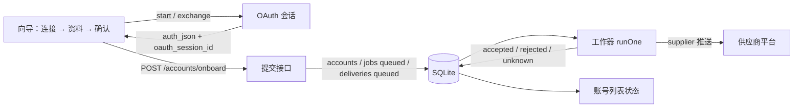

# Claude 授权录入

实现日期：2026-11-09。此功能把“新建并上号”的主要入口改为浏览器授权，再补充供应商资料。生成链接、回填、校验和失败分支已在本地测试；尚未使用真实 Claude 账号授权或执行真实供应商交付。

## 总览

上号链路分五段：前端向导 → OAuth 会话（仅服务端内存）→ 提交接口 → 后台工作器 → 列表状态派生。下文各节是每段的细节，本节只给主干。

**前端向导**（`AccountFormDialog` + `useAccountOnboarding`）三步：① 连接账号——选平台连接与代理池条目，再用「登录 Claude」（OAuth）、「粘贴凭证 JSON」或手动填写三种方式拿到凭证；② 补充资料——补齐密码、套餐起止、设备标识等缺项（已有账号重授权时为「补充设备与凭证」）；③ 确认上号——提交 `POST /accounts/onboard`（带 `Idempotency-Key`；已有账号走 `/accounts/{id}/onboard` 并带 `expected_version`），凭证来自 OAuth 时附 `oauth_session_id`。成功后「继续添加下一个」保留连接与代理、清空其余字段。

**OAuth 会话**（`oauth_sessions.go`）：`start` 先看同一浏览器会话（owner）是否已有活动链接——绑定（出口、账号）相同则 200 复用并带 `stage`，不同则 409 `OAUTH_SESSION_CONFLICT`，显式 `refresh` 才替换；新建链接依次过冷却检查、代理绑定检查（已绑定代理池条目的账号只能在原代理授权）、账号租约（期间其他写操作 409 `ACCOUNT_IN_PROGRESS`）、UA 指纹、全局闸门排队（≤30 秒）与出口探测。`exchange` 校验授权码与 state、冷却，排队 ≤30 秒后访问上游（token → profile → roles，合计 ≤60 秒，与浏览器连接解耦）：成功则缓存结果、对账号 ID/邮箱播种 60 秒冷却、回写代理绑定并返回 `auth_json` 与 `oauth_session_id`；429 记入冷却并保留链接；token 阶段的 JSON 4xx 终止会话；拦截页、网络错误与 5xx 保留会话可重试；令牌已取得后可空 `result` 续取。会话 30 分钟过期，最多 512 条，不落库、不跨实例。

**提交接口**（`onboard.go` + `oauth_write_guard.go`）：带 `oauth_session_id` 时由写保护中间件核对会话归属、账号、凭证指纹、邮箱与出口一致，并借用会话已持有的账号锁，否则按普通账号写入加锁；随后补默认值、解析代理、校验输入、检查连接；已有账号读旧凭证并应用凭证不变量（新鲜度以 `last_refresh` 为主序，设备 ID 显式 > 已存 > 生成）；事务内幂等键命中则回放原任务，否则写入/更新 `accounts`（UPDATE 只覆盖可选资料字段，保留内部元数据）、密封凭证与密码、插入 `jobs(account.submit, queued)` 与 `deliveries(queued)`，返回 202 `{account_id, job_id, state: queued}`。授权成功本身不创建账号、不向供应商上传。

**后台工作器**（`worker.go`，串行取最早的 queued 任务）：先按来源算一次预热延迟（手动 1–3 秒、批量 5–15 秒，可配，0 关闭）写入 payload 的 `not_before_at`，任务保持 queued 等待，重排队不再等；认领为 running，账号锁拿不到则重排队；前置检查：已 accepted → `succeeded/ALREADY_LINKED`，已有 unknown 投递 → `unknown`，版本冲突、已归档、连接停用、密钥缺失、凭证不可读 → `failed`；解析代理（凭证里已有不同 `proxy_url` → `PROXY_BINDING_CHANGED`，无代理 → `PROXY_REQUIRED`）；应用凭证不变量并预留设备 ID（失败重试沿用同一 ID）；最后向供应商推送（关机也跑完）：成功写 `deliveries/platform_links = accepted`，明确拒绝 → `failed/rejected`，网络不确定 → `unknown`（不自动重试，需人工处理）。

**列表状态**（`account_delivery.go`，按页派生）：`pending`（无任务）→ `submitting`（queued/running）→ `linked`（有 accepted 链接）/ `failed` / `unknown`（结果不确定或成功但本地链接缺失）；卡片带 `submission_job` 的错误码、提示与允许动作（重试 / 放弃）。

## 使用流程

1. 打开账号管理 → 新建账号，选择已有代理。若暂不选代理，授权请求使用服务端直连或代理池配置的前置代理；交付前仍需选择代理或提供真实 `proxy_url`。
2. 点击“生成 Claude 授权链接”，复制链接或点击打开按钮，在 Claude 页面登录自己的账号并允许授权。
3. 将授权页提供的授权码、`code#state` 或完整回调地址粘贴到“授权结果”，点击“获取并填充资料”。
4. 授权成功后面板收起为“已授权”卡片（邮箱、组织、套餐、令牌到期），下方出现“还差 N 项才能上号”清单：交付密码、套餐开始/结束日期、设备标识（可直接在清单内填写）、平台连接、交付代理；授权未返回邮箱、套餐或注册日期时这三项也会列出；粘贴的凭证 JSON 缺字段时会多一项“凭证字段”，列出缺少的 `auth_json` 字段名。设备标识填好后输入框仍保留在清单内可继续修改。日期顺序错误（如套餐开始晚于结束）不算缺项，清单头部改为“日期顺序有误”，提交时沿用原有的明确报错。每项可点“去填写”跳到对应字段，填好即打勾。表单里待补字段带“待补充”标记，授权带回的账号、套餐、注册日期带“已自动获取”标记。粘贴 JSON 凭证后同样进入该清单模式。
5. 点击“创建并上号”。若仍有缺项，不发送请求，而是定位并高亮第一个缺项；页脚始终显示“还差 N 项 / 资料已完整”。授权成功本身不会创建账号或向供应商上传。实现与设计记录见 `docs/superpowers/specs/2026-11-09-oauth-completion-checklist-design.md`。

保留“已有凭证？粘贴 JSON 或手动填写”入口。关闭窗口清空本次密码、授权码和令牌；新生成的授权结果只在当前表单中暂存，最终提交沿用现有 AES-GCM 加密流程。授权链接只适用于本次管理会话，30 分钟后失效，重新生成会替换该会话的旧链接；应用重启也会使链接失效。

## 自动填充边界

| 字段                                       | 来源与处理                                                                                 |
| ------------------------------------------ | ------------------------------------------------------------------------------------------ |
| access/refresh token、有效期、最近获取时间 | 实际授权码兑换结果，`expired` 由响应的 `expires_in` 计算                                   |
| 邮箱、账号 UUID、组织 UUID                 | Token 响应及 profile 响应；profile 身份与 token 不匹配时不采用 profile                     |
| 组织名称                                   | profile/token 提供时采用，否则尝试 roles 接口；缺失则留空                                  |
| 套餐                                       | 仅映射已知 `rate_limit_tier`：Pro、Max 5x、Max 20x；其他值提示手选                         |
| 注册日期                                   | profile 中实际账号创建时间；无法解析则留空                                                 |
| 交付代理                                   | 后端解析所选代理池记录，在完整凭证校验前填入，无需回显代理密码                             |
| 密码、套餐起止日期、设备标识               | 不从 OAuth 猜测，不用随机设备 ID 或 Token 到期日代替                                       |
| type / verification_status                 | 沿用现有表单默认 `claude` / `not_required`，可手动修改；并非上游已验证或供应商已接收的证明 |

已移除新账号默认“今天注册、今天开通、下个月到期”和默认 Max 20x，避免把默认值误当成授权返回的真实资料。没有新建数据库表或修改历史账号。

## 实际 API

以下路径以 `/api/v1` 为前缀，全部要求已登录、`accounts.onboard` 权限；POST/DELETE 还要求现有 Origin、CSRF、写限速校验。

| 方法/路径                                   | 请求                                                                                                                                          | 响应                                                                                                                                                                                                                                                                                                                                                                                                                                   |
| ------------------------------------------- | --------------------------------------------------------------------------------------------------------------------------------------------- | -------------------------------------------------------------------------------------------------------------------------------------------------------------------------------------------------------------------------------------------------------------------------------------------------------------------------------------------------------------------------------------------------------------------------------------- |
| `POST /claude-oauth/sessions`               | `{ "proxy_id": "可选的代理 ID", "account_id": "重授权时可选的本地账号 ID", "email": "可选，新账号已知邮箱时用于单飞匹配", "refresh": false }` | 201 新建或 200 复用同 owner、同出口与账号的活动会话；同 owner 的活动会话绑定了别的出口或账号时返回 409 `OAUTH_SESSION_CONFLICT`（details 给出该会话的 `oauth_session_id`、`proxy_id`、`account_id`、`stage`），需 `refresh: true` 替换或先 DELETE；`id`、`authorization_url`、`expires_at`、`proxy_id`、`account_id`、`stage`（`pending` / `profile` 令牌已取得待读资料 / `ready` 已完成可直接取回）；冷却时可附 `retry_after_seconds` |
| `POST /claude-oauth/sessions/{id}/exchange` | `{ "result": "授权码、code#state 或回调地址；会话已持有令牌（stage 为 profile / ready）时可为空" }`                                           | 200，`oauth_session_id`、`auth_json`（仅本次新获取凭证）、可选 `plan`、`register_time`、`warnings`；提交时把 `oauth_session_id` 一并带上，服务端据此核对凭证与出口                                                                                                                                                                                                                                                                     |
| `DELETE /claude-oauth/sessions/{id}`        | 无                                                                                                                                            | 200，撤销当前管理会话拥有的待授权链接并释放账号租约                                                                                                                                                                                                                                                                                                                                                                                    |

返回沿用 `{data,request_id}` 包装及 `Cache-Control: no-store`。state/格式错误返回 422 `OAUTH_RESULT_INVALID`，可修改输入再提交；链接过期、被替换、已完成或不属于当前会话返回 404 `OAUTH_SESSION_EXPIRED`。同一待授权会话只允许一个兑换请求进入排队或访问上游，重复请求返回 429 `OAUTH_BUSY`；正在兑换的会话不能被刷新替换。`OAUTH_BUSY` 的 `details.oauth_busy_reason` 给出原因，`retry_after_seconds` 随原因变化：`session_in_flight` 2 秒、`owner_lock` 5 秒、`queue_timeout` / `exit_timeout` / `pacing_timeout`（30 秒排队预算用尽）约 10 秒带抖动、`store_full` 15 秒、`cancelled` 1 秒；`/metrics` 以 `cc_manager_oauth_busy_total{reason}` 计数。

Token 兑换成功但 profile 返回 429 时，在待授权会话内存中保留令牌与原授权码摘要，错误响应不返回令牌。冷却后提交同一授权结果（或空 `result`）只重新读取 profile，不再兑换已消费的授权码；提交别的授权码返回 422 `OAUTH_RESULT_INVALID`。Token 阶段返回 400/404/409、JSON 错误体的 401/403，或成功响应数据无效时终止会话，错误带 `details.oauth_session_expired=true`，前端清除失效链接；Token 阶段收到非 JSON 体的 401/403（代理、WAF 或认证门户的拦截页）判定为授权码未到达上游，返回 `OAUTH_PROXY_UNREACHABLE`（`oauth_stage=token`）并保留会话，可原链接重试；缓存令牌在会话等待期间过期时返回 404 `OAUTH_SESSION_EXPIRED`（同样带该标记）并终止会话。网络中断不能确定上游是否已消费授权码；保留会话供重试，若随后返回已使用错误则重新授权。Token 5xx 保留会话；profile/roles 返回 401/403 保留令牌并报身份拒绝（`OAUTH_IDENTITY_REJECTED`，会话保留）；profile 网络、5xx 或异常资料响应保留令牌，返回已获取字段供补填或按阶段重试。兑换一旦开始访问上游便不再随浏览器断开而取消：结果缓存在会话内，浏览器重试（空 `result`）即可取回。

冷却键有三种：已有账号按账号 ID；兑换返回邮箱后另按邮箱；新账号在拿到邮箱前按已登录的浏览器会话（owner）。上游 429 对当前会话的全部键生效；兑换成功后只对账号 ID / 邮箱播种 60 秒冷却，不碰 owner 键，因此同一操作者「继续添加下一个」不会被自己上一个账号的成功限流。重新生成或取消链接不会清除冷却。等待遵从上游 Retry-After，仅保留 60 秒业务下限，不再叠加 1 小时上限；缺失时等待 60 秒。前端按钮、Enter、粘贴自动提交和刷新入口按响应秒数倒计时，服务端仍独立校验。冷却与待授权状态仅在当前进程内存中，不跨重启或实例共享；同一 owner 的待授权链接在进程内单飞复用，绑定不同的请求得到 409 而不是旧链接，显式刷新才会作废旧链接；前端收到 409 后把按钮切换为「作废并重新获取」并以 `refresh: true` 重发。

待授权信息仅保存于内存，最多 512 条，每分钟清理过期项；PKCE verifier 不返回浏览器。上游响应体、令牌和代理认证信息不拼接到错误或审计日志。请求固定使用按账号稳定的 UA/Accept-Language 指纹，新号冷却可用邮箱别名参与；管理员可在代理列表页配置全局并发（默认 3）、单出口并发（默认 2）、兑换间隔（默认 3 秒）、探测缓存（默认 30 秒）、预热（手动默认 1–3 秒、批量默认 5–15 秒，上限填 0 关闭）与 UA 池。预热在任务仍处于排队状态时等待，延迟写入任务 payload 的 `not_before_at`：重启后任务仍是排队态，不会被当作结果未知；账号忙碌重新排队后沿用同一时间戳，不会再等一次。选中代理池记录时生成链接前先经该代理探测令牌端点：Claude 对 GET 返回 JSON 403，算作可达；429 按账号/会话记入冷却并返回 `OAUTH_RATE_LIMITED`；其余任何失败（连接失败、超时、非 JSON 的 401/403、5xx、200 非 JSON）一律返回 `OAUTH_PROXY_UNREACHABLE`（`oauth_stage=reach`），因为此时尚未提交任何身份，不会被归为身份被拒或响应异常。全局并发与单出口并发在进程启动时从已保存设置加载，保存后立即生效，重启不回退到内置默认值。回调地址仅解析，不访问用户粘贴的 URL；对外请求使用固定 HTTPS 端点，不跟随重定向，响应限制 1 MiB。兑换预算：排队最多 30 秒（全局并发闸门、单出口闸门与出口间隔共用这一预算，期间浏览器断开即放弃，授权码未被使用），取得额度后上游各阶段合计最多 60 秒（每个外部请求最多 18 秒，含阶段间 0.2–1.2 秒停顿），因此一次合法请求最长约 90 秒；前端等待 95 秒。出队后再次检查会话有效性与冷却。前置代理设置与代理池检测共用，浏览器登录的网络不由服务端控制。

重新授权已有账号时，服务端在核对账号身份后沿用已保存的设备标识、代理和账号 UUID；同组织可补齐缺失的组织名称；凭证新鲜度早于库内版本时拒绝覆盖（以 `last_refresh` 为主序，本次刷新更晚即接受；相同或缺失时才比较 `expired`，因此导入时写得过远的有效期不会阻塞后续授权）。新 token、刷新时间、有效期和本次组织 UUID 不从旧凭证补齐。缺少可用资料时仍显示补填入口；设备标识持久化后，重试与再提交沿用同一值。省略 `proxy_id`、传入 `account_id` 的 OAuth 会话可使用密封凭证内的代理，生成链接和兑换时均校验该账号写权限；旧凭证不回传前端。新建账号仍必须填写全部必填资料。

## 参数依据与待验证项

读取了 Claude 官方认证文档 `https://code.claude.com/docs/en/authentication`，并对照本机安装的官方 `@anthropic-ai/claude-code` 2.1.223 客户端，核实授权地址、client ID、手动回调地址、JSON Token 兑换参数以及 profile/roles 路径。没有读取本机 Claude 账号配置、Cookie 或登录令牌。

这些客户端端点不等于已获得稳定的第三方 OAuth 集成契约。实际客户端或服务端变化、权限范围及供应商字段规则仍需用用户自己的账号联调确认。当前实现使用 `user:profile user:inference user:sessions:claude_code` 权限，不请求 API Key 创建权限；未实现长期 Token 刷新。

真实联调需确认：授权页是否接受当前参数、Token 响应实际字段、profile/roles 可用性、供应商要求的 `claude_device_ids` 来源及取值，以及完整资料是否被供应商接收。任何模拟测试通过都不代表上述真实链路已验证。

## 初始实现的验证与恢复

- 原始行为：新建表单需逐项补充凭证；选择代理池仍因空 `proxy_url` 被完整性校验阻断。原版前端 31 项测试、Go app/supplier 测试通过。
- 新增测试先覆盖缺失的 OAuth 实现与代理字段问题，再实现修复。新增客户端测试使用本机 HTTP 模拟服务；浏览器测试使用真实本地管理 API 创建授权会话、拒绝错误 state，仅将外部授权成功响应模拟后验证填充。
- `go test -race -count=1 ./cmd/... ./internal/...`：通过；`go vet ./cmd/... ./internal/...`：通过。
- `npm test -- --reporter=dot`：10 个文件、37 项通过；`npm run lint`：0 错误、10 个既有 `any` 警告；`npm run format:check`：通过。
- `npm run build`（含 vue-tsc）及 `go build -o bin/cc-manager ./cmd/cc-manager`：通过；构建仍有 Element Plus chunk 大于 500 kB 的提示。
- `playwright test`：6 项通过。首次完整回归发现原有代理设置测试查找已拆分的旧文案，已改为断言实际模式标题，保留修改路径与保存状态的原验证内容。
- 未完成：真实 Claude 授权、真实供应商接收，以及设备标识来源的供应商确认。

原始文件及 SHA256、统一差异、测试日志、恢复脚本位于 `/tmp/cc-manager-oauth-20261109/`。源目录原本全部为 Git 未跟踪文件，本次未创建提交；`changes.patch` 仅包含本次差异。

恢复脚本先核对所有当前文件与本次最终 SHA256，拒绝覆盖后续改动。可先运行 `python3 /tmp/cc-manager-oauth-20261109/restore.py /Users/disaster/GoProject/cc-manager` 检查；确认恢复时添加 `--apply`，然后重建前后端。恢复脚本的实际写入仅在额外临时副本验证，工作目录保留本次实现。`/tmp` 可能被系统清理，需要长期保留时请保存该目录。
